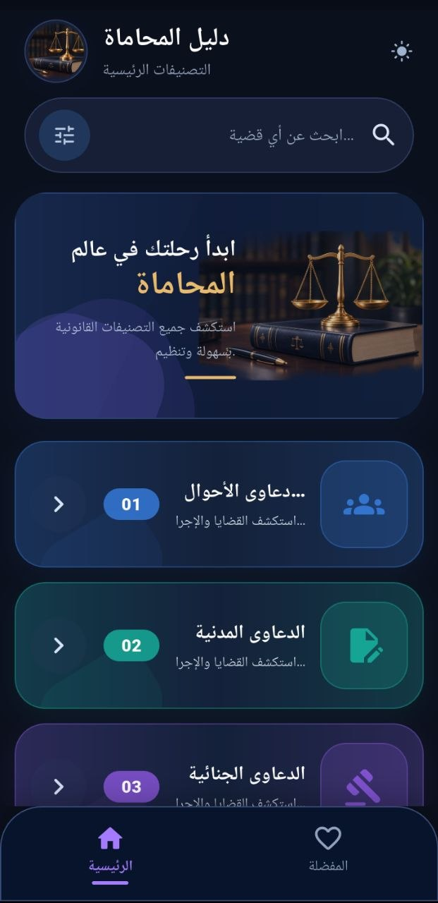
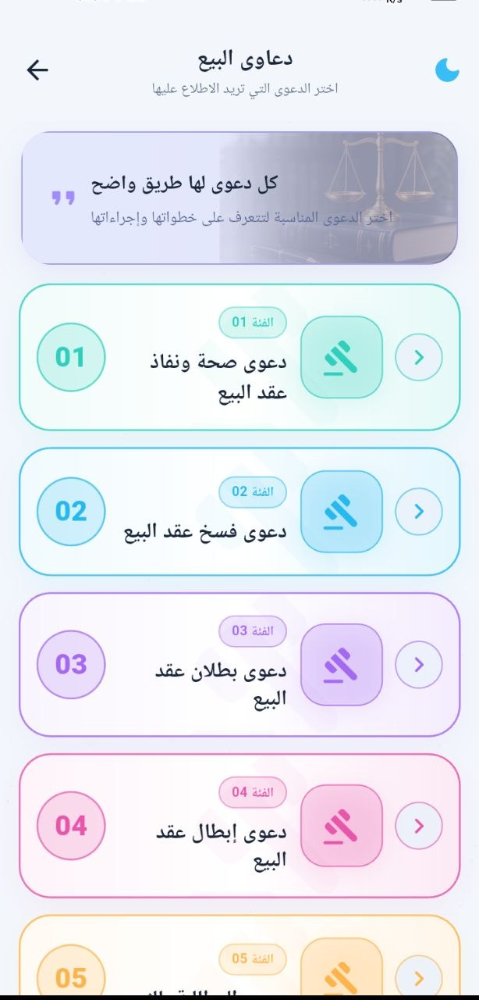
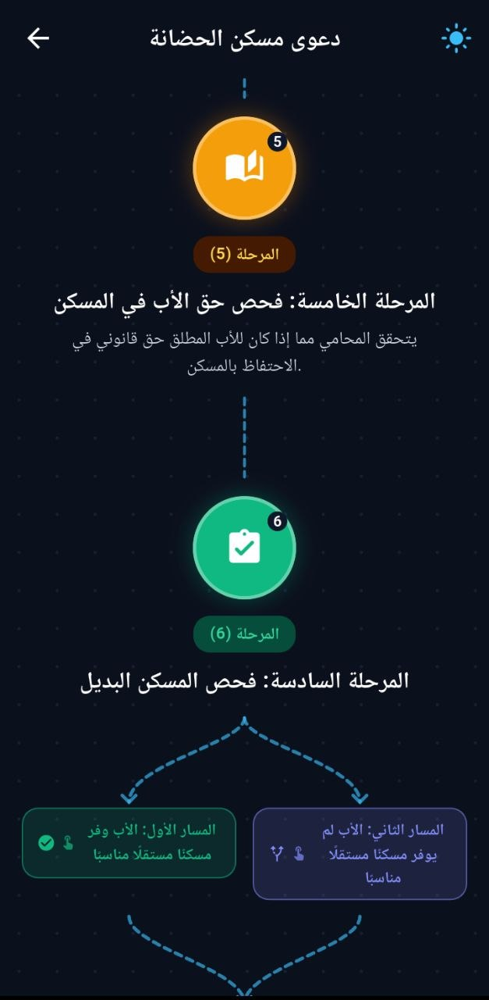
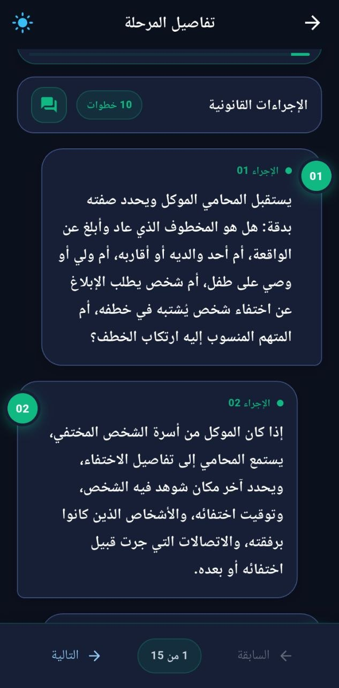
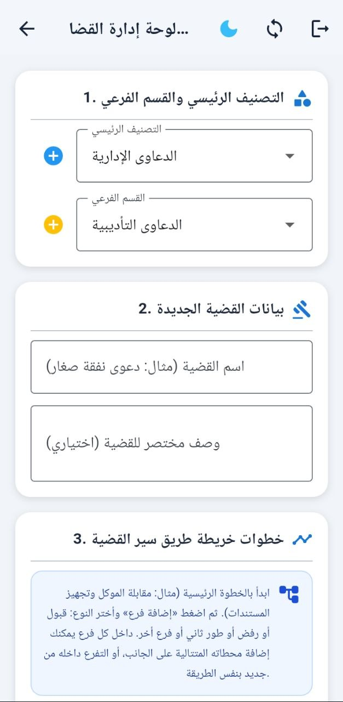

# دليل المحاماة — Legal Guide (Learn Law)

A Flutter mobile application that gives lawyers, law students and the general public an
organized, offline-ready reference for legal procedures: every dispute is broken down into
categories → subcategories → cases → step-by-step roadmaps → outcomes (branches).

---

## Table of Contents

- [Project Name](#project-name)
- [About the Project](#about-the-project)
- [Features](#features)
- [Technologies Used](#technologies-used)
- [Getting Started](#getting-started)
- [Screenshots](#screenshots)

---

## Project Name

**دليل المحاماة** (app title displayed in `MaterialApp`) — package name: **`learn_law`**.

---

## About the Project

### What the app does

"دليل المحاماة" is a legal-procedure guide. Instead of reading a whole book to find what
happens next in a case, the user browses a tree of content and follows a roadmap:

```
Category  (التصنيف الرئيسي)     e.g. family law, criminal law, civil law
 └── Subcategory  (القسم الفرعي)
      └── Legal Case  (القضية / الدعوى)
           └── Step 1 → Step 2 → Step 3 …   (the roadmap)
                └── Branches: acceptance / rejection / appeal / custom
```

Each step has a title, a detailed explanation, a list of sub-steps, and one or more
**branches** — the possible outcomes of that step (e.g. "قبول" acceptance, "رفض" rejection,
"استئناف/الثاني" appeal, or a free-form custom path). Each branch can itself contain nested
branches, so a whole procedural decision tree can be represented. The content is authored
in Arabic and the UI is RTL-first.

### The problem it solves

Legal procedure is scattered, mostly memorized orally, and hard to look up on the spot —
especially for junior lawyers, paralegals, law students and citizens who have to file
something themselves. Printed guides are heavy and not searchable, and the answer is
rarely "the law says X" but "what is the exact next document/step and what happens if it
is rejected?" This app turns that procedural knowledge into a structured, searchable,
always-available checklist with all the branching outcomes visible up front.

### Goal

- Make legal procedure a guided path instead of a dense legal text.
- Keep the entire guide available with **no internet connection** (offline-first).
- Let the administrator maintain content centrally (Supabase) and have it propagate to
  every device automatically, without the end user ever seeing an "update" step.

### Target users

- Practicing lawyers and junior associates who need a quick procedural reference.
- Paralegals and legal office staff who prepare case files and paperwork.
- Law students learning the practical order of procedures and their outcomes.
- Citizens who want to understand what a case involves before hiring a lawyer.

---

## Features

Everything below was verified against the source code.

### Browsing & reading

- **Category browsing** — home screen lists all categories with a numbered accent card,
  icon and description (`features/legal_cases/presentation/screens/categories_screen.dart`).
- **Subcategory browsing and case listing** — drill down from category → subcategory →
  case (`subcategories_screen.dart`, `legal_cases_screen.dart`, `legal_cases_screen.dart`).
- **Case roadmap** — a vertical, color-coded roadmap of the case steps displayed inside a
  grid/pattern background (`case_roadmap_screen.dart`, `widgets/step_palette.dart`).
- **Step detail with branching outcomes** — each step shows its explanation, sub-steps and
  its outcome branches color-coded by type: acceptance (green), rejection (red),
  appeal (amber), custom (indigo) (`step_detail_screen.dart`, `step_detail_v2.dart`).
- **Nested branch detail** — any branch can be opened to read its own description and its
  child branches (`branch_detail_screen.dart`, `domain/entities/step_branch.dart`).
- **Step navigation** — move between steps of the same case directly from the detail page.

### Search & favorites

- **Global case search** — searches the whole case library by title on the device with a
  400 ms debounce, returns results with their folder path (subcategory name), and opens
  the roadmap straight from a result (`global_search_screen.dart`,
  `LocalDataSource.searchLegalCases`).
- **Favorites tab** — long-press a category to pin it, and bookmark specific cases with the
  favorite button; both appear under the "المفضلة" bottom tab
  (`state/legal_case_favorites.dart`, `widgets/legal_case_favorite_button.dart`).

### Offline-first architecture

- **Full local copy** — categories, subcategories, legal cases and case steps are all stored
  in a local SQLite database (Drift), and **every read is served from that local database**.
  The repository never talks to Supabase, so screens never wait on the network
  (`data/repositories/legal_repository_impl.dart`).
- **Crash-safe write queue** — each local mutation writes the row *and* appends an operation
  to an outbox (`sync_queue`) inside a single transaction. The queue entry is only removed
  after the server acknowledges the write, so a crash replays it instead of losing it
  (`core/sync/local_data_source.dart`, `core/sync/sync_manager.dart`).
- **Queue coalescing** — repeated offline edits to the same row collapse into one push
  carrying only the final state.
- **Bidirectional sync** — pending writes are pushed first, then changes are pulled.
  Rows are reconciled on `updated_at` with last-write-wins; a local row with pending
  changes is never overwritten by a stale pull.
- **Incremental pull with watermarks** — a per-table `sync_state` watermark fetches only
  rows changed since the last successful sync, paginated at 500 rows.
- **Soft deletes** — deletes set `deleted_at` locally and on the server, so an offline device
  learns *that* a row was deleted instead of silently never seeing it. Cascading soft delete
  removes a whole subtree (category → subcategories → cases → steps).
- **Automatic sync triggers** — sync runs at app start (background, non-blocking), whenever
  connectivity returns, and screens refresh themselves when a sync completes
  (`core/sync/sync_refresh_listener.dart`).
- **Focused step refresh** — when a roadmap is opened, that case's steps are re-pulled
  immediately so a case opened mid-sync never looks like it is missing steps.
- **Graceful offline fallback** — if a refresh fails, the user is told the saved copy on the
  device is being shown.

### Admin / content management

- **Hidden admin entry** — tapping the app title 5 times within 2 seconds opens the admin
  area (`categories_screen.dart` → `_handleSecretTap`).
- **Supabase email/password login with an email whitelist** — non-whitelisted accounts are
  rejected before the request, and are force-signed-out if they somehow authenticate
  (`admin_login_screen.dart`).
- **Admin hub** — create a legal case under any category/subcategory with a title,
  description and any number of steps (`admin_hub_screen.dart`).
- **Roadmap editor** — build per-step branches by kind (acceptance / rejection / appeal /
  custom), with sub-steps, nesting and a live preview (`widgets/roadmap_editor.dart`).
- **Case editor** — edit an existing case: rename it, rewrite its description, move it to
  another folder, edit/reorder/delete steps and their branches
  (`admin_edit_case_screen.dart`, `widgets/roadmap_editor.dart`).
- **Admin writes work offline too** — admin screens write to the local database and queue
  the changes for sync exactly like the reader side.

### UI / UX

- **Dark and light themes** with a toggle available on every screen
  (`core/app_theme.dart`, `ThemeToggleButton`).
- **Arabic-first RTL layout** with a responsive, max-width constrained layout for tablets
  and wide windows.
- **Custom visual identity** — gold/navy palette, starry and grid backgrounds, gradient
  category cards, custom welcome banner with the app's scale artwork
  (`widgets/starry_background.dart`, `assets/images/mizan.png`).
- **Text hygiene** — a shared filter strips decorative symbols/emoji from legal text on
  every read and write path, so stored content stays clean
  (`core/legal_text.dart`).
- **Splash-free startup** — the first frame renders immediately; the initial sync continues
  in the background.

### Quality

- Widget tests for the home screen, subcategory list tiles, roadmap tiles, banner golden
  images, step navigation, theme behavior and cubit lifecycle.
- Unit tests for search, roadmap renumbering and legal-text filtering.

---

## Technologies Used

### Language & framework

| Item | Version | Notes |
|---|---|---|
| Dart | SDK `^3.12.2` | Declared in `pubspec.yaml` |
| Flutter | stable channel (Material 3) | `uses-material-design: true` |
| Platforms | Android, iOS, Web, Windows, macOS, Linux | All platform folders present |

### State management & architecture

- **`flutter_bloc` ^9.1.1** — a single `LegalCubit` with explicit states
  (`LegalInitial`, `LegalLoading`, `CategoriesLoaded`, `SubcategoriesLoaded`,
  `LegalCasesLoaded`, `CaseStepsLoaded`, `LegalError`) for loading/browsing data, plus
  refresh methods per level.
- **Clean architecture layering** — `domain` (entities, repository interface, use cases),
  `data` (Supabase data source, models, repository implementation), `presentation`
  (cubit, screens, widgets). One feature module: `legal_cases`.
- **`get_it` ^9.2.1** — service locator: `registerFactory` for the cubit,
  `registerLazySingleton` for use cases, repository, data sources, database, connectivity
  service and sync manager (`core/injection_container.dart`).
- **Flutter's built-in `ValueNotifier` / `ChangeNotifier`** — theme controller and the
  in-memory favorites store.

### Backend & persistence

- **Supabase (`supabase_flutter` ^2.17.2)** — Postgres database with the tables
  `categories`, `subcategories`, `legal_cases`, `case_steps`; used both as the sync target
  (REST via the Supabase client) and for **Supabase Auth** (email + password admin login).
  The client is initialized in `main()` with the project URL and publishable (anon) key.
- **Drift (`drift` ^2.34.0` + `drift_flutter` ^0.3.0`)** — type-safe SQLite ORM. Local
  tables: `categories`, `subcategories`, `legal_cases`, `case_steps`, plus `sync_queue`
  (outbox) and `sync_state` (per-table watermarks). Code generation with `drift_dev` and
  `build_runner`; database file named `learn_law`.
- **`sqlite3_flutter_libs` ^0.6.0`** — bundled SQLite native libraries for Android/iOS.
- **`path_provider` ^2.1.5` / `path` ^1.9.1`** — database file location.
- **`connectivity_plus` ^6.1.5`** — transport-level online/offline detection that triggers
  a sync when the connection comes back.
- **`uuid` ^4.5.1`** — client-generated v4 UUIDs so a row has its final primary key before
  it is ever pushed, which is what makes upserts and offline inserts possible.

### Tooling & assets

- **`flutter_launcher_icons` ^0.14.4`** — generates Android/iOS launcher icons, including an
  adaptive icon with background `#0B101D`.
- **`flutter_lints` ^6.0.0`** — lint ruleset (`analysis_options.yaml`).
- **`flutter_test`** — widget and unit tests; `test/goldens/` holds golden images.

> Note: `lib/features/legal_cases/data/datasources/legal_remote_data_source.dart` still exists
> and is registered in the service locator, but reads are served by the local database; the
> sync engine is the component that actually talks to Supabase.

---

## Getting Started

### 1. Prerequisites

- **Flutter SDK** (stable channel) with a Dart SDK compatible with `^3.12.2` —
  check with `flutter --version`.
- **Android Studio** (Android SDK + emulator) and/or **Xcode** on macOS for iOS —
  verify with `flutter doctor`.
- **Git**.
- A **Supabase** project that contains the four content tables (see step 4).

### 2. Clone the project

```bash
git clone <YOUR_REPOSITORY_URL>
cd learn_law
```

### 3. Install dependencies

```bash
flutter pub get
```

### 4. Generate the Drift database code

The Drift code (`lib/core/sync/app_database.g.dart`) is generated. Regenerate it after
cloning or after changing any table definition:

```bash
dart run build_runner build --delete-conflicting-outputs
```

> For continuous regeneration while developing (e.g. `flutter run -d windows`):
> `dart run build_runner watch --delete-conflicting-outputs`

### 5. Configure Supabase

1. In the Supabase dashboard, create (or reuse) the tables `categories`, `subcategories`,
   `legal_cases` and `case_steps`.
2. Open **SQL Editor → New query** and run the contents of
   [`supabase_sync_migration.sql`](supabase_sync_migration.sql). The script is idempotent and:
   - adds the `updated_at` and `deleted_at` columns to all four tables (and backfills them),
   - installs `touch_updated_at()` triggers so `updated_at` is always current,
   - indexes `updated_at` for fast incremental pulls.
3. Create the admin account under **Authentication → Users** (email + password). The app
   currently authorizes a single whitelisted admin email, defined in
   `lib/features/legal_cases/presentation/screens/admin_login_screen.dart`
   (`_authorizedAdminEmail`) and re-checked in `categories_screen.dart`. Change it there to
   the account you created.
4. Set the project credentials in `lib/main.dart`:

   ```dart
   await Supabase.initialize(
     url: 'https://<YOUR-PROJECT-REF>.supabase.co',
     anonKey: '<YOUR-PUBLISHABLE-ANON-KEY>',
   );
   ```

   > **Security note:** the repository currently contains a live Supabase URL and publishable
   > key hard-coded in `main.dart`. That key is safe to ship (it is a public anon key) **only
   > if RLS is configured correctly**. Before publishing the app, rotate the key, and prefer
   > injecting it via `--dart-define` rather than committing it.

### 6. Run the app

```bash
flutter devices                  # list available devices
flutter run                      # run on the currently selected device
flutter run -d chrome            # web
flutter run -d windows           # Windows desktop
flutter run -d <emulator-id>     # a specific Android emulator / iOS simulator
```

On first launch the app opens with the local database empty and starts a background sync;
categories appear once the pull finishes (or immediately, if the device is offline and
content was already synced before).

### 7. (Optional) Regenerate launcher icons

After replacing `assets/images/app_icon.png` or `app_icon_contained.png`:

```bash
dart run flutter_launcher_icons
```

### 8. Useful commands

| Command | Purpose |
|---|---|
| `flutter analyze` | Static analysis (uses `flutter_lints`) |
| `flutter test` | Run all unit and widget tests |
| `flutter test/categories_screen_test.dart` | Run a single test file |
| `flutter test --update-goldens` | Regenerate golden images in `test/goldens/` |
| `flutter build apk --release` | Build a release Android APK |
| `flutter build web --release` | Build a release web bundle |

### 9. Project structure

```
lib/
├── main.dart                       # Supabase init, DI init, sync start, MaterialApp
├── core/
│   ├── app_theme.dart              # Dark/light tokens, ThemeData, theme toggle button
│   ├── injection_container.dart    # get_it registrations
│   ├── legal_text.dart             # Symbol-stripping text filter
│   └── sync/
│       ├── app_database.dart       # Drift tables + code-generated accessors
│       ├── local_data_source.dart  # Local reads/writes + outbox queueing
│       ├── sync_manager.dart       # Push/pull reconciliation engine
│       ├── connectivity_service.dart
│       ├── sync_refresh_listener.dart
│       └── sync_types.dart         # Table names, operations, status enums
└── features/legal_cases/
    ├── domain/                     # Entities, repository contract, use cases
    ├── data/                       # Supabase data source, models, repository impl
    └── presentation/
        ├── bloc/                   # LegalCubit + states
        ├── screens/                # Home, subcategories, cases, roadmap, step, branch,
        │                           # global search, admin login / hub / edit case
        ├── state/                  # Favorites store
        └── widgets/                # Roadmap editor, tiles, backgrounds, text formatter
```

---
## Screenshots

The following screenshots showcase the main features and user interface of Legal Guide. All images are stored in the `screenshots/` directory at the project root.

### 1. Home Screen — Dark Theme

<p align="center">
  
</p>

### 2. Subcategories — Light Theme

<p align="center">
  
</p>

### 3. Case Roadmap

<p align="center">
  
</p>

### 4. Step Details

<p align="center">
  
</p>

### 5. Admin Dashboard

<p align="center">
  
</p>

---


---

<p align="center">Made with Flutter · Arabic-first legal procedural guide</p>
